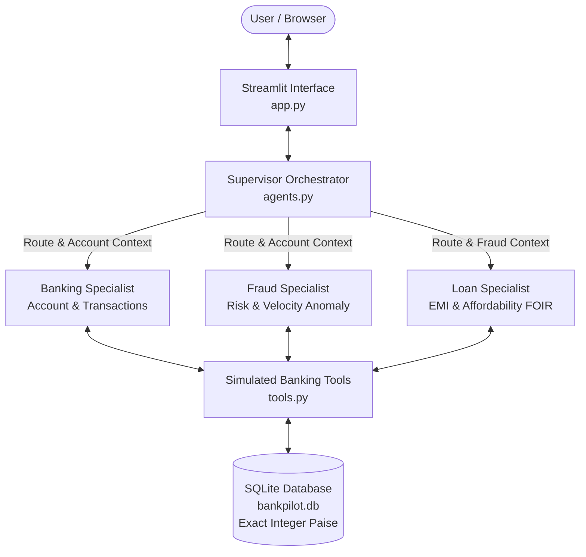

# BankPilot AI — Explainable Multi-Agent Banking Simulator

BankPilot AI is an explainable multi-agent banking simulator built for small business (SME) banking operations, real-time risk assessment, and loan underwriting. It features a Supervisor Orchestrator, three specialized agents (Banking, Fraud, Loan), an exact integer-paise SQLite ledger, and an interactive Streamlit interface with an explainable execution trace.

---

## 🏛️ Architecture Overview

The system uses plain Python orchestration with strict agent allowlists, code-injected customer scoping, and transparent execution logging:



---

## 📋 Assignment Requirement Mapping

| Requirement | Implementation Module | Description |
|:---|:---|:---|
| **Supervisor Orchestrator** | `agents.py` (`route_query_with_llm`, `process_user_query`) | Routes requests using Groq LLM (or deterministic fallback), validates routes, and coordinates Banking → Fraud → Loan sequential execution. |
| **Banking Specialist** | `agents.py`, `tools.py` | Authorized strictly for balance inquiries, account profiles, and transaction history. |
| **Fraud Specialist** | `agents.py`, `tools.py` | Detects high-value debits (>= ₹50,000) and rapid velocity bursts (>= 3 debits within 24 hours). |
| **Loan Specialist** | `agents.py`, `tools.py` | Computes mathematical EMI and Fixed Obligation to Income Ratio (FOIR <= 50%). Holds loans for review if fraud flags are active. |
| **Exact Integer Accounting** | `database.py` (`rupees_to_paise`, `format_inr`) | Stores all currency in integer paise (₹1 = 100 paise) to prevent floating-point balance corruption. |
| **Customer Scope Security** | `agents.py` (`dispatch_tool_call`) | Customer ID is injected strictly by application code; untrusted model inputs cannot override tenant boundaries. |
| **Five Supported Use Cases** | `agents.py`, `app.py`, `test_core.py` | Covers balance, transactions, fraud, loan affordability, and combined 3-agent evaluation. |
| **Transaction Simulator** | `app.py`, `database.py` | Explicit form to post credits/debits with no-overdraft simulation enforcement. |
| **Explainable Trace** | `app.py` (`ExecutionTraceItem`) | Visualizes agent name, tool called, sanitized arguments, latency in milliseconds, model, and status. |
| **Honest AI Status & Fallback** | `agents.py`, `app.py` | Explicitly distinguishes Live LLM success, API failure fallback, and Demo Fallback mode. |

---

## 👥 The Two Demo Accounts (Sample Business Accounts)

> *“These are sample business accounts with fictional data. Choose one to explore its balance, transactions and loan affordability.”*

The database automatically seeds two realistic sample accounts:

* **`CUST-101` — Apex Traders (Proprietor: Rajesh Sharma)**
  * **Account Type:** Current Account - SME
  * **Opening Balance:** ₹2,00,000.00 | **Available Balance:** ₹2,37,000.00
  * **Declared Monthly Income:** ₹1,50,000.00 | **Existing Monthly EMI:** ₹15,000.00 (10% FOIR)
  * **Actual Stored Records:** Wholesale supplier with steady operational cashflow, balanced credits and debits, and zero policy breaches.
  * **Simulation Role:** Ideal for demonstrating clean account inquiries and approved loan affordability (15.9% total debt-to-income).

* **`CUST-102` — BlueHorizon Logistics (Proprietor: Priya Nair)**
  * **Account Type:** Current Account - Transport Commercial
  * **Opening Balance:** ₹3,50,000.00 | **Available Balance:** ₹3,55,000.00
  * **Declared Monthly Income:** ₹2,50,000.00 | **Existing Monthly EMI:** ₹40,000.00 (16% FOIR)
  * **Actual Stored Records:** High-turnover fleet freight operator with a recent single debit of ₹65,000 (exceeding the ₹50,000 threshold) and 3 debits within the last 24 hours.
  * **Simulation Role:** Ideal for demonstrating fraud policy detection and underwriter review hold on loan applications.

Selecting an account scopes all displayed data, tools, chat context, and results strictly to that account. Switching accounts automatically clears conversation history and pending contexts.

---

## 🎯 The Five Core Use Cases

The simulator natively supports and validates these exact demonstration queries:

1. **"Show my balance and account details."**  
   *Route:* `Banking Specialist`  
   *Output:* Current balance, opening balance, account type, declared income, and existing commitments.

2. **"Show my last five transactions."**  
   *Route:* `Banking Specialist`  
   *Output:* Chronological table of credits and debits formatted with timestamps and descriptions.

3. **"Are any recent transactions suspicious?"**  
   *Route:* `Fraud Specialist`  
   *Output:* Evaluates single-debit threshold (>= ₹50,000) and 24-hour rapid velocity bursts (>= 3 debits).

4. **"Can I afford a ₹1 lakh loan over 12 months?"**  
   *Route:* `Loan Specialist`  
   *Output:* Mathematical EMI calculation (₹8,885/mo @ 12%), existing EMI total, and Debt-to-Income (FOIR) evaluation against the 50% policy limit.

5. **"Check my account and suspicious transactions before assessing whether I can afford a ₹1 lakh loan over 12 months."**  
   *Route:* `Banking Specialist` → `Fraud Specialist` → `Loan Specialist`  
   *Output:* Complete holistic review. If suspicious activity exists (e.g., in customer `CUST-102`), the loan is marked as **Held for Underwriter Manual Review** while transparently displaying all financial calculations.

---

## 🛡️ Fictional Fraud & Loan Policies

All financial calculations and policy outcomes come strictly from deterministic tools in `tools.py`:

* **Fraud Policy 1 (Large Debit Threshold):** Any single `DEBIT >= ₹50,000` (5,000,000 paise) triggers a `LARGE_DEBIT_THRESHOLD` high-risk warning.
* **Fraud Policy 2 (Rapid Debit Velocity):** `3 or more DEBITs` within a rolling `24-hour window` triggers a `RAPID_DEBIT_VELOCITY` medium-risk warning.
* **Loan EMI Formula:** Computed via standard amortization in code:
  $$E = P \cdot r \cdot \frac{(1+r)^N}{(1+r)^N - 1} \quad (\text{for } r > 0), \quad E = \frac{P}{N} \quad (\text{for } r = 0)$$
  where $r = \frac{\text{annual rate}}{12 \times 100}$.
* **Affordability Threshold:** Proposed Total EMI $(\text{Existing EMI} + \text{Proposed EMI}) \le 50\%$ of declared monthly income (FOIR $\le 50\%$).
* **Fraud-Loan Interaction:** If unresolved suspicious activity exists, the loan is marked as `REQUIRES_MANUAL_REVIEW`. *A flag does not prove fraud, and affordability does not guarantee credit approval.*

---

## 🛠️ Prerequisites & Technology Stack

- **Operating System:** Windows 10 or 11 (64-bit).
- **Python:** Python 3.11 or 3.12 installed on your system.
- **Shell:** Windows PowerShell.
- **Core Libraries:**
  - `streamlit`: Clean web dashboard and reactive user interface.
  - `groq`: Fast inference SDK with native tool-calling support (`qwen/qwen3.8-27b`).
  - `python-dotenv`: Local environment configuration.
  - `pytest`: Automated test harness (21 automated checks).
  - `sqlite3`: Python standard library database.

---

## 🚀 Step-by-Step Setup Instructions (Windows PowerShell)

Open Windows PowerShell and run:

### 1. Navigate to Project Directory
```powershell
cd D:\BankPilotAI
```

### 2. Create Virtual Environment
```powershell
python -m venv .venv
```

### 3. Install Dependencies
Directly execute the virtual environment's pip without requiring changes to PowerShell execution policies:
```powershell
.\.venv\Scripts\python.exe -m pip install -r requirements.txt
```

### 4. Configure Environment Variables
Copy the template configuration file:
```powershell
Copy-Item .env.example .env
```

Open `.env` in Notepad:
```powershell
notepad .env
```

Add your Groq API key:
```ini
GROQ_API_KEY=gsk_your_groq_api_key_here
GROQ_MODEL=qwen/qwen3.8-27b
```

> **How to get a free Groq API Key:**
> 1. Visit [Groq Console](https://console.groq.com/keys).
> 2. Sign in and click **"Create API Key"**.
> 3. Paste the key into `.env`.
> 
> *Note: If no API key is provided, BankPilot AI automatically activates **Demo Fallback Mode**, allowing 100% offline testing of all five workflows.*

---

## 🧪 Running Automated Verification Tests

Run the full automated test suite covering ledger consistency, fraud detection, EMI math, amount parsing, and security boundaries:

```powershell
.\.venv\Scripts\python.exe -m pytest -v test_core.py
```

All 21 tests execute in temporary isolated databases and complete in under 1 second.

---

## 💻 Launching the Application

Start the Streamlit web dashboard:

```powershell
.\.venv\Scripts\python.exe -m streamlit run app.py
```

The application will open in your browser at `http://localhost:8501`.

---

## 🎮 5–10 Minute Demo Walkthrough

When presenting this project to evaluators:

1. **Orientation (1 min):**
   - Point out the clean UI header and the notice banner (*"Demo data only. All customer balances, transactions, fraud rules and loan assessments are fictional simulation records."*).
   - Show the **AI Engine Status** in the sidebar (indicates Live Groq LLM or Demo Fallback Mode).
   - Point out the integer-paise SQLite database automatically created on first launch (`bankpilot.db`).

2. **Clean Account Assessment — Apex Traders (2 mins):**
   - Select `CUST-101 — Apex Traders` in the sidebar.
   - Click **Quick Button 1 ("1. Balance & Details")**: Show the clean account overview (Available: ₹2,37,000.00).
   - Click **Quick Button 4 ("4. ₹1 Lakh Loan Affordability")**:
     - Point out the calculated EMI (₹8,885/month).
     - Show total EMI (₹23,885) is ~15.9% of income (well below the 50% limit).
     - Observe the outcome: `✅ AFFORDABLE (Within Policy)`.
   - Expand the **Explainable Agent Activity Trace** on the right to show tool arguments, execution latency, and specialist status.

3. **Risk & Anomaly Detection — BlueHorizon Logistics (2 mins):**
   - Switch to `CUST-102 — BlueHorizon Logistics` in the sidebar dropdown. Notice how chat context resets cleanly.
   - Click **Quick Button 3 ("3. Suspicious Check")**:
     - The Fraud Specialist flags two violations:
       1. *Large Debit Threshold:* Single debit of ₹65,000 for hydraulic equipment exceeds ₹50,000.
       2. *Rapid Velocity:* 3 debits in the last 24 hours.
   - Click **Quick Button 5 ("5. Combined 3-Agent Review")**:
     - Watch the multi-agent cascade: Banking → Fraud → Loan.
     - Notice the loan outcome: `⚠️ HELD FOR UNDERWRITER MANUAL REVIEW`.
     - Explain how the fraud finding was passed forward to prevent automated loan approval while still presenting transparent EMI calculations.

4. **Transaction Simulator & Overdraft Protection (2 mins):**
   - Expand the **Transaction Simulator** form. Post a debit of ₹15,000.
   - Show that the ledger updates immediately and the available balance reflects the deduction.
   - Now attempt to post an excessive debit (e.g., ₹10,00,000).
   - Demonstrate the immediate rejection under the simulated no-overdraft policy (`Insufficient funds`).

5. **Demo Reset (30 seconds):**
   - Click **"Reset Demo Data"** in the sidebar to show how state and seed records are restored to pristine baseline.

---

## ⚖️ Project Limitations & Scope

- **Focused Academic MVP:** Implements a focused subset of the reference architecture for student submission.
- **Fictional Simulation:** All customer records, transaction histories, interest rates, and risk policies are simulated for academic demonstration.
- **Single Hosted Model:** One configurable hosted LLM (`qwen/qwen3.8-27b`) is shared across agent personas via distinct prompts and tool allowlists.
- **No External Integrations:** In-process tools simulate core banking; there are no live core banking integrations, user authentication, external credit bureaus, or distributed streaming infrastructure (e.g. Kafka).
