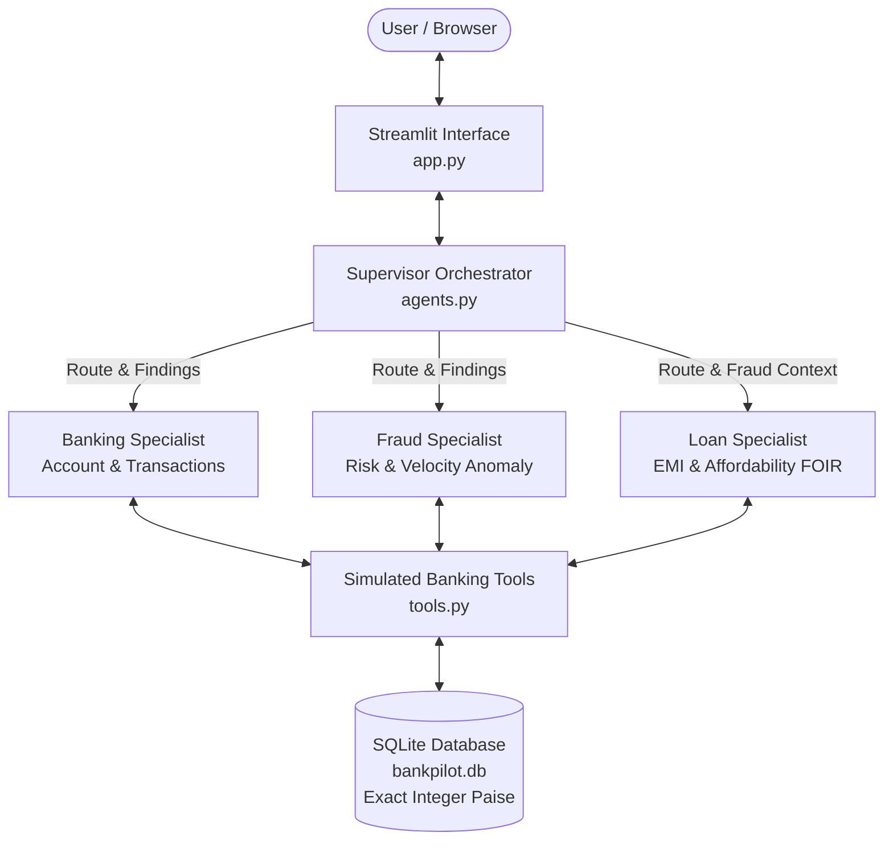

# BankPilot AI — Explainable Multi-Agent Banking Simulator

BankPilot AI is an explainable multi-agent banking simulator built for small business (SME) banking operations, real-time risk assessment, and loan underwriting. It features a Supervisor Orchestrator, three specialized agents (Banking, Fraud, Loan), an exact integer-paise SQLite ledger, and an interactive Streamlit interface with an explainable execution trace.

---

## 🏛️ Architecture Overview

The system uses plain Python orchestration with strict agent allowlists, code-injected customer scoping, and transparent execution logging:



---

## 📋 Assignment Requirement Mapping

| Requirement | Implementation Module | Description |
|:---|:---|:---|
| **Supervisor Orchestrator** | `agents.py` (`route_query_with_llm`, `process_user_query`) | Routes requests using Groq LLM (or deterministic fallback), validates routes, and coordinates Banking → Fraud → Loan sequential execution. |
| **Banking Specialist** | `agents.py`, `tools.py` | Authorized strictly for balance inquiries, account profiles, and transaction history. |
| **Fraud Specialist** | `agents.py`, `tools.py` | Detects high-value debits (>= ₹50,000) and rapid velocity bursts (>= 3 debits within 24 hours). |
| **Loan Specialist** | `agents.py`, `tools.py` | Computes mathematical EMI and Fixed Obligation to Income Ratio (FOIR <= 50%). Holds loans for review if fraud flags are active. |
| **Exact Integer Accounting** | `database.py` (`rupees_to_paise`, `format_inr`) | Stores all currency in integer paise (₹1 = 100 paise) to prevent floating-point balance corruption. |
| **Customer Scope Security** | `agents.py` (`dispatch_tool_call`) | Customer ID is injected strictly by application code; untrusted model inputs cannot override tenant boundaries. |
| **Five Supported Use Cases** | `agents.py`, `app.py`, `test_core.py` | Covers balance, transactions, fraud, loan affordability, and combined 3-agent evaluation. |
| **Transaction Simulator** | `app.py`, `database.py` | Explicit form to post credits/debits with no-overdraft simulation enforcement. |
| **Explainable Trace** | `app.py` (`ExecutionTraceItem`) | Visualizes agent name, tool called, sanitized arguments, latency in milliseconds, model, and status. |
| **Demo Fallback Mode** | `agents.py` (`execute_specialist_fallback`) | Deterministic engine ensures full functionality even without an internet connection or Groq API key. |

---

## 🎯 The Five Core Use Cases

The simulator natively supports and validates these exact demonstration queries:

1. **"Show my balance and account details."**  
   *Route:* `Banking Specialist`  
   *Output:* Current balance, opening balance, account type, declared income, and existing commitments.

2. **"Show my last five transactions."**  
   *Route:* `Banking Specialist`  
   *Output:* Chronological table of credits and debits formatted with timestamps and descriptions.

3. **"Are any recent transactions suspicious?"**  
   *Route:* `Fraud Specialist`  
   *Output:* Evaluates single-debit threshold (>= ₹50,000) and 24-hour rapid velocity bursts (>= 3 debits).

4. **"Can I afford a ₹1 lakh loan over 12 months?"**  
   *Route:* `Loan Specialist`  
   *Output:* Mathematical EMI calculation, existing EMI total, and Debt-to-Income (FOIR) evaluation against the 50% policy limit.

5. **"Check my account and suspicious transactions before assessing whether I can afford a ₹1 lakh loan over 12 months."**  
   *Route:* `Banking Specialist` → `Fraud Specialist` → `Loan Specialist`  
   *Output:* Complete holistic review. If suspicious activity exists (e.g., in customer `CUST-102`), the loan is marked as **Held for Underwriter Manual Review** while transparently displaying all financial calculations.

---

## 👥 Fictional Customer Profiles

The database automatically seeds two realistic small-business profiles:

* **`CUST-101` — Apex Traders (Owner: Rajesh Sharma)**
  * **Profile:** Stable wholesale supplier.
  * **Declared Monthly Income:** ₹1,50,000.
  * **Existing Monthly EMI:** ₹15,000.
  * **Transaction History:** Consistent operational expenses and client settlements with **no fraud flags**. Ideal for demonstrating approved affordability.

* **`CUST-102` — BlueHorizon Logistics (Owner: Priya Nair)**
  * **Profile:** Transport & fleet operator.
  * **Declared Monthly Income:** ₹2,50,000.
  * **Existing Monthly EMI:** ₹40,000.
  * **Transaction History:** Includes a high-value debit (₹65,000) and rapid debits within 24 hours. Ideal for demonstrating **fraud rule triggers and underwriter loan holds**.

---

## 🛠️ Prerequisites & Technology Stack

- **Operating System:** Windows 10 or 11 (64-bit).
- **Python:** Python 3.11 or 3.12 installed on your system.
- **Shell:** Windows PowerShell.
- **Core Libraries:**
  - `streamlit`: Clean web dashboard and reactive user interface.
  - `groq`: Fast inference SDK with native tool-calling support.
  - `python-dotenv`: Local environment configuration.
  - `pytest`: Automated test harness.
  - `sqlite3`: Python standard library database.

---

## 🚀 Step-by-Step Setup Instructions (Windows PowerShell)

Open PowerShell and run the following commands:

### 1. Navigate to Project Directory
```powershell
cd D:\BankPilotAI
```

### 2. Create Virtual Environment
```powershell
python -m venv .venv
```

### 3. Install Dependencies
Directly execute the virtual environment's pip without needing to modify PowerShell execution policies:
```powershell
.\.venv\Scripts\python.exe -m pip install --upgrade pip
.\.venv\Scripts\python.exe -m pip install -r requirements.txt
```

### 4. Configure Environment Variables
Copy the template configuration file:
```powershell
Copy-Item .env.example .env
```

Open `.env` in Notepad or your editor:
```powershell
notepad .env
```

Fill in your Groq API key:
```ini
GROQ_API_KEY=gsk_your_actual_groq_api_key_here
GROQ_MODEL=llama-3.3-70b-versatile
```

> **How to get a free Groq API Key:**
> 1. Visit the official Groq Console: [https://console.groq.com/keys](https://console.groq.com/keys).
> 2. Sign in with Google or GitHub.
> 3. Click **"Create API Key"**, give it a name, copy the key, and paste it into `.env`.
> 
> *Note: If you do not have an API key right now, BankPilot AI automatically activates **Demo Fallback Mode**, which allows you to run, test, and demo all five use cases deterministically.*

---

## 🧪 Running Automated Tests

Run the full automated test suite covering ledger consistency, fraud detection, EMI math, amount parsing, and security boundaries:

```powershell
.\.venv\Scripts\python.exe -m pytest -v test_core.py
```

All tests execute in isolated temporary databases and complete in seconds.

---

## 💻 Launching the Application

Start the Streamlit web dashboard:

```powershell
.\.venv\Scripts\python.exe -m streamlit run app.py
```

The application will automatically open in your default browser at `http://localhost:8501`.

---

## 🎮 5–10 Minute Demo Walkthrough

When presenting this project to interviewers or evaluators, follow this recommended walkthrough:

1. **Orientation (1 min):**
   - Point out the clean UI header and the disclaimer banner (*"Simulation only. All customer data, fraud rules and loan assessments are fictional."*).
   - Show the **Status Indicator** in the sidebar (Live Groq LLM or Demo Fallback Mode).
   - Highlight the integer-paise SQLite database automatically created on first launch (`bankpilot.db`).

2. **Clean Profile Assessment — Apex Traders (2 mins):**
   - Select `CUST-101` in the sidebar.
   - Click **Quick Button 1 ("Balance & Details")**: Show the clean account overview.
   - Click **Quick Button 4 ("₹1 Lakh Loan Affordability")**:
     - Point out the EMI calculation (₹8,885/month).
     - Show that total EMI (₹23,885) is ~15.9% of income, well below the 50% FOIR limit.
     - Observe the outcome: `✅ AFFORDABLE (Within Policy)`.
   - Expand the **Explainable Execution Trace** on the right to show tool arguments, execution latency, and specialist status.

3. **Risk & Anomaly Detection — BlueHorizon Logistics (2 mins):**
   - Switch to `CUST-102` in the sidebar dropdown.
   - Click **Quick Button 3 ("Suspicious Check")**:
     - The Fraud Specialist flags two violations:
       1. *Large Debit Threshold:* Single debit of ₹65,000 for hydraulic equipment exceeds ₹50,000.
       2. *Rapid Velocity:* 3 debits in the last 24 hours.
   - Click **Quick Button 5 ("Combined 3-Agent Evaluation")**:
     - Watch the multi-agent cascade: Banking → Fraud → Loan.
     - Notice the loan outcome: `⚠️ HELD FOR UNDERWRITER MANUAL REVIEW`.
     - Explain how the fraud finding was passed forward to prevent automated loan approval while still presenting transparent EMI calculations.

4. **Transaction Simulator & Overdraft Protection (2 mins):**
   - In the **Transaction Simulator Form**, post a new debit of ₹15,000.
   - Show that the ledger updates immediately and the available balance reflects the deduction.
   - Now attempt to post an excessive debit (e.g., ₹10,00,000).
   - Demonstrate the immediate rejection under the simulated no-overdraft policy (`Insufficient funds`).

5. **Demo Reset (30 seconds):**
   - Click the **"Reset Demo Data"** button in the sidebar to show how state and seed data are restored to pristine condition.

---

## 🔒 Security & Architectural Decisions

* **Customer Scope Injection:**  
  The LLM is strictly prohibited from selecting or overriding the `customer_id`. The application session injects the verified active customer ID directly into the tool dispatcher.
* **Deterministic Fallback Engine:**  
  If the Groq API key is missing or network connectivity is interrupted, the application switches to a deterministic pattern engine without crashing or disrupting the demo.
* **Integer Paise Arithmetic:**  
  Currency is stored as integer paise in SQLite (`₹100.50` = `10050` paise) to prevent floating-point rounding accumulation errors.
* **Simulated Real-Time Definition:**  
  "Simulated real-time" refers to immediate transactional processing of user-generated events and rule evaluations in memory/SQLite; this is not a distributed streaming Kafka platform.
* **No Secret Leakage:**  
  API keys, raw credentials, and internal chain-of-thought tokens are never rendered in the UI or written to logs.

---

## 💡 Top 5 Likely Interview Questions & Answers

### Q1: Why did you store balances in integer paise instead of floating-point numbers?
> **Answer:** In financial systems, binary floating-point representations (like Python `float` or SQL `FLOAT`) suffer from base-2 conversion inaccuracies (e.g., `0.1 + 0.2 = 0.30000000000000004`). Over millions of transactions, these rounding errors compound into balance discrepancies. By storing amounts in integer paise (`₹1 = 100 paise`), all ledger operations use exact integer addition and subtraction.

### Q2: How do you prevent the LLM from accessing data belonging to another customer?
> **Answer:** We enforce customer-scope boundaries in application code, not in prompts. When a specialist agent requests a tool call, the tool dispatcher ignores any `customer_id` supplied by the model and injects the trusted `customer_id` from the authenticated session state directly into the tool parameters.

### Q3: Why did you use an explicit Supervisor instead of letting one LLM handle all tasks?
> **Answer:** A single generic prompt is prone to hallucination, role bleeding, and security risks. By separating into a Supervisor and three bounded Specialists (Banking, Fraud, Loan), each agent has a narrow system instruction, a strict tool allowlist, and independent testability.

### Q4: How do the Fraud and Loan agents communicate in the combined evaluation?
> **Answer:** The Supervisor orchestrates execution in canonical order: Banking → Fraud → Loan. The Fraud Specialist evaluates transaction anomalies first. If unresolved flags are detected, the findings are injected into the Loan Specialist's context. The loan tool then marks the assessment as `REQUIRES_MANUAL_REVIEW`, ensuring that high-risk accounts are never falsely marked as approved.

### Q5: What happens if Groq is down or the user does not have an API key?
> **Answer:** BankPilot AI includes an automatic, visibly labelled **Demo Fallback Mode**. When the Groq client is unavailable, the Supervisor and Specialists fall back to deterministic regex pattern matchers and rule-based dispatchers. This allows offline demonstration of all 5 use cases without compromising reliability.

---

## ⚖️ Project Limitations & Scope

- **Fictional Simulation:** All customer records, transaction histories, interest rates, and risk policies are simulated for academic demonstration.
- **Single Hosted Model:** One configurable hosted LLM (`llama-3.3-70b-versatile`) is shared across agent personas via distinct prompts and tool allowlists.
- **In-Process Tools:** Banking APIs and credit checks are simulated via local SQLite functions; there are no live core banking integrations or external credit bureaus.
