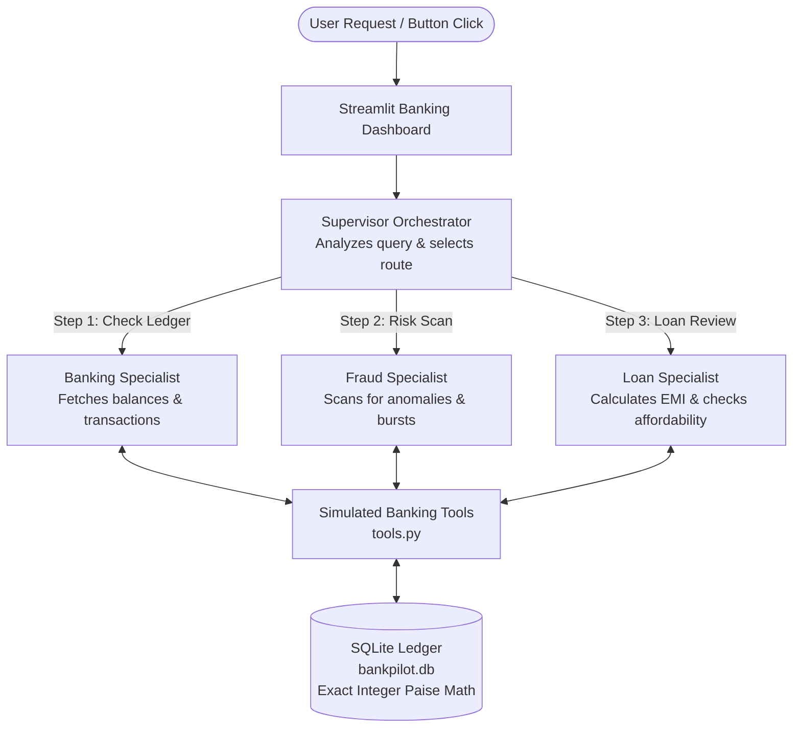

# 🏦 BankPilot AI — Explainable Multi-Agent Banking Simulator

> **An explainable multi-agent AI system for SME banking operations, real-time risk assessment, and loan underwriting.**

Built with **Python**, **Streamlit**, **SQLite**, and **Groq LLM** (`qwen/qwen3.8-27b`).

---

## 📌 Table of Contents
- [Quick Start in 3 Steps](#-quick-start-in-3-steps)
- [How It Works (Multi-Agent Workflow)](#-how-it-works-multi-agent-workflow)
- [The 4 Agents Explained](#-the-4-agents-explained)
- [The 2 Demo Accounts](#-the-2-demo-accounts)
- [The 5 Demo Questions](#-the-5-demo-questions)
- [Setup Guide for Any System (Windows / Mac / Linux)](#-setup-guide-for-any-system)
- [Groq API Key Setup (Free)](#-groq-api-key-setup-free)
- [How to Test the Project](#-how-to-test-the-project)
- [Simulator & Reset Features](#-simulator--reset-features)

---

## ⚡ Quick Start in 3 Steps

If you want to run the application immediately:

```bash
# 1. Clone the repository
git clone https://github.com/kishorein25/BankPilot-AI.git
cd BankPilot-AI

# 2. Create virtual environment and install dependencies
python -m venv .venv
# On Windows:
.\.venv\Scripts\pip install -r requirements.txt
# On Mac/Linux:
./.venv/bin/pip install -r requirements.txt

# 3. Launch the dashboard
# On Windows:
.\.venv\Scripts\python -m streamlit run app.py
# On Mac/Linux:
./.venv/bin/python -m streamlit run app.py
```
*The app will automatically open in your browser at `http://localhost:8501`!*

> **No API Key? No Problem!**  
> BankPilot AI has an automatic **Demo Fallback Mode**. You can immediately run and test all 5 banking workflows offline without entering an API key.

---

## 🧠 How It Works (Multi-Agent Workflow)

Instead of sending user questions into one generic prompt, BankPilot AI uses a **Supervisor Orchestrator** and **Three Specialized Specialist Agents**:



### Key Workflow Rules:
1. **Application-Injected Security:** The active account ID is injected by code, never chosen by the AI. The model cannot access another customer's data.
2. **Canonical Ordering:** Multi-agent reviews always run in order: **Banking $\rightarrow$ Fraud $\rightarrow$ Loan**.
3. **Structured Finding Passing:** If the Fraud Specialist finds suspicious activity, it passes this flag directly to the Loan Specialist to hold the loan for review.
4. **Deterministic Math:** All financial calculations (EMI, balances, debt ratios) come directly from verified code tools, not hallucinated model text.

---

## 🤖 The 4 Agents Explained

| Agent | Role | Authorized Tools | Key Rule |
|:---|:---|:---|:---|
| **Supervisor** | Orchestrator | Router (`route_query_with_llm`) | Decides which specialists to invoke. Coordinates findings and compiles final response. |
| **Banking Specialist** | Account & Ledger | `get_customer_account_summary`, `get_account_balance_tool`, `get_recent_transactions_tool` | Retrieves current balance, opening balance, and recent transaction history. Never guesses balances. |
| **Fraud Specialist** | Risk & Anomalies | `analyze_suspicious_activity_tool` | Flags single debits $\ge$ ₹50,000 and $\ge 3$ debits in 24 hours. A flag means *review required*, not proven fraud. |
| **Loan Specialist** | Affordability & EMI | `calculate_loan_affordability_tool` | Calculates monthly EMI and FOIR (Debt-to-Income $\le 50\%$). Holds loan for Underwriter Review if fraud flags exist. |

---

## 👥 The 2 Demo Accounts

The project automatically seeds two fictional sample business accounts into SQLite:

### 1. `CUST-101` — Apex Traders (Proprietor: Rajesh Sharma)
- **Business Type:** Wholesale goods & supplies (Current Account - SME).
- **Available Balance:** ₹2,37,000.00 (from ₹2,00,000 opening + ₹82,000 credits - ₹45,000 debits).
- **Declared Monthly Income:** ₹1,50,000.00 / month.
- **Existing Monthly EMI:** ₹15,000.00 / month (10% FOIR).
- **Risk Status:** **Clean (0 Flags)** — Normal operational debits spread over several days.
- **Demo Purpose:** Demonstrates clean account inquiries and **Approved Loan Affordability**.

### 2. `CUST-102` — BlueHorizon Logistics (Proprietor: Priya Nair)
- **Business Type:** Transport & commercial fleet fleet (Current Account - Commercial).
- **Available Balance:** ₹3,55,000.00 (from ₹3,50,000 opening + ₹1,20,000 credits - ₹1,15,000 debits).
- **Declared Monthly Income:** ₹2,50,000.00 / month.
- **Existing Monthly EMI:** ₹40,000.00 / month (16% FOIR).
- **Risk Status:** **Flagged for Review (2 Triggers)**:
  1. *Large Debit Rule:* Single debit of ₹65,000 (exceeds ₹50,000 limit).
  2. *Velocity Burst Rule:* 3 debits in the last 24 hours (₹65k, ₹10k, ₹15k).
- **Demo Purpose:** Demonstrates **Fraud Rule Triggering** and **Loan Underwriter Hold** on an account that passes math affordability but requires human risk review.

---

## 🎯 The 5 Demo Questions

You can test these queries via the **1-click quick demo buttons** in the dashboard:

1. **"Show my balance and account details."**
   - *Active Agent:* Banking Specialist.
   - *Result:* Shows available balance, opening balance, income, and existing commitments.

2. **"Show my last five transactions."**
   - *Active Agent:* Banking Specialist.
   - *Result:* Displays chronological transaction history table with dates, types, and amounts.

3. **"Are any recent transactions suspicious?"**
   - *Active Agent:* Fraud Specialist.
   - *Result:* Runs risk policy check. Returns **Clean** for `CUST-101` and **Flagged** for `CUST-102`.

4. **"Can I afford a ₹1 lakh loan over 12 months?"**
   - *Active Agent:* Loan Specialist.
   - *Result:* Calculates exact EMI (₹8,885/mo @ 12% p.a.). Shows total debt ratio (15.9% vs 50% max) and confirms **Affordable**.

5. **"Check my account and suspicious transactions before assessing whether I can afford a ₹1 lakh loan over 12 months."**
   - *Active Agents:* Banking $\rightarrow$ Fraud $\rightarrow$ Loan.
   - *Result:* For `CUST-102`, fraud flags are passed to the loan agent. The assessment calculates affordability transparently but marks the loan as **Held for Underwriter Manual Review**.

---

## 💻 Setup Guide for Any System

### Requirements:
- Python 3.11 or Python 3.12 installed.
- Git installed.

### On Windows (PowerShell):
```powershell
# 1. Clone repository
git clone https://github.com/kishorein25/BankPilot-AI.git
cd BankPilot-AI

# 2. Create virtual environment
python -m venv .venv

# 3. Install packages
.\.venv\Scripts\pip.exe install -r requirements.txt

# 4. Run application
.\.venv\Scripts\python.exe -m streamlit run app.py
```

### On macOS / Linux:
```bash
# 1. Clone repository
git clone https://github.com/kishorein25/BankPilot-AI.git
cd BankPilot-AI

# 2. Create virtual environment
python3 -m venv .venv

# 3. Install packages
./.venv/bin/pip install -r requirements.txt

# 4. Run application
./.venv/bin/python -m streamlit run app.py
```

---

## 🔑 Groq API Key Setup

You can run BankPilot AI in two ways:

### Option A: Built-in Demo Mode (Zero Setup - Clone & Run)
- If you don't configure an API key, the system automatically uses its **deterministic offline engine**.
- All 5 banking workflows, loan affordability assessments, fraud detection rules, and the transaction simulator work 100% out of the box with zero setup!

### Option B: Live AI Mode (Free Groq Key)
To enable live AI model execution with `qwen/qwen3.8-27b`:
1. Get a free API key at [https://console.groq.com/keys](https://console.groq.com/keys).
2. In the project folder, create a `.env` file from the example:
   ```bash
   # Windows PowerShell
   Copy-Item .env.example .env
   # Mac/Linux
   cp .env.example .env
   ```
3. Open `.env` and paste your key:
   ```ini
   GROQ_API_KEY=gsk_your_key_here
   GROQ_MODEL=qwen/qwen3.8-27b
   ```
4. Restart the app. The sidebar will immediately show:  
   `🟢 Live LLM Request Succeeded (Model: qwen/qwen3.8-27b)`.

---

## 🧪 How to Test the Project

BankPilot AI includes a comprehensive automated test suite with **21 tests** covering accounting math, overdraft protection, fraud rules, Indian currency parsing, and security permissions.

Run tests using:
```bash
# Windows
.\.venv\Scripts\python.exe -m pytest -v test_core.py

# Mac/Linux
./.venv/bin/python -m pytest -v test_core.py
```

**Test Coverage Summary:**
- ✅ Balance consistency across multiple credits/debits.
- ✅ Overdraft protection (rejecting debits exceeding available balance).
- ✅ Fraud large-debit threshold ($\ge$ ₹50,000) and velocity burst detection.
- ✅ EMI mathematical formula verified against independent hand calculation.
- ✅ Zero-interest EMI edge case ($E = P / N$).
- ✅ Indian amount expression parsing (`₹1 lakh`, `1.5 lakhs`, `100000`, `1 crore`).
- ✅ Customer scope enforcement (preventing malicious ID overrides).
- ✅ Tool allowlist enforcement (blocking unauthorized tool calls).
- ✅ Automatic graceful fallback during API outages or timeouts.

---

## 💳 Simulator & Reset Features

- **Transaction Simulator:**  
  In the right sidebar/panel, expand the **Transaction Simulator** form. Post a simulated credit or debit (e.g. ₹25,000). The ledger updates immediately, balance refreshes, and the next question reads the new data.
- **Overdraft Protection:**  
  Try posting a debit larger than available balance (e.g. ₹10,00,000). The simulator immediately rejects it under the simulated no-overdraft policy.
- **Reset Demo Data Button:**  
  Click **"Reset Demo Data"** in the sidebar at any time to restore pristine seed records.

---

## 📄 License & Academic Note
Simulation only. Built for the **Wrench Wise Internship Assignment Evaluation**. All customer data, transactions, fraud rules, and loan assessments are fictional simulation records.
