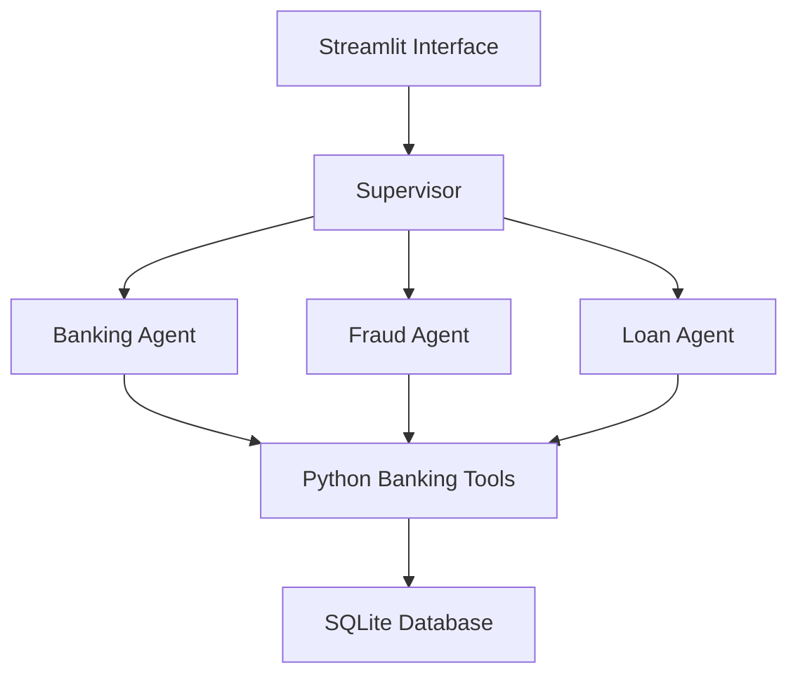

# BankPilot AI

A simulated banking application built for the Wrench Wise AI/ML internship assignment.

- Built using Python, Streamlit, SQLite and Groq.
- Uses a supervisor and three specialized agents for banking, fraud checks and loan affordability.
- Includes a transaction simulator and agent activity logs.

## Features

- Check account details and available balance.
- View recent transactions.
- Check suspicious activity using simple rules.
- Calculate loan EMI and affordability.
- Run a combined account, fraud and loan assessment.
- Add demo credits and debits.

## Technology

| Technology | Purpose |
|---|---|
| Python | Application logic and calculations |
| Streamlit | Banking dashboard and chat |
| SQLite | Fictional accounts and transactions |
| Groq API | LLM routing and tool selection |
| Pytest | Automated tests |

## Setup and Run

Install Python 3.11 or 3.12 and Git.

Open Windows PowerShell and run:

```powershell
git clone https://github.com/kishorein25/BankPilot-AI.git
cd BankPilot-AI

python -m venv .venv

.\.venv\Scripts\python.exe -m pip install -r requirements.txt

.\.venv\Scripts\python.exe -m streamlit run app.py
```

Open http://localhost:8501 in your browser.

The app creates the SQLite database and sample accounts automatically.

Press **Ctrl+C** in PowerShell to stop the application.

## Enable Live AI

Without an API key, the app uses rule-based demo fallback mode.

To enable Groq:

1. Create an API key at https://console.groq.com/keys.
2. Create your local configuration file:

```powershell
Copy-Item .env.example .env
```

3. Open `.env` and enter your key:

```ini
GROQ_API_KEY=your_api_key_here
```

4. Choose a currently supported Groq model with tool calling from https://console.groq.com/docs/models.
5. Set its model ID in PowerShell and start the app:

```powershell
$env:GROQ_MODEL = "YOUR_SUPPORTED_MODEL_ID"

.\.venv\Scripts\python.exe -m streamlit run app.py
```

Set the model before launching because the current code reads it when the agent module loads.

Keep your API key private. Check the agent activity logs to confirm whether each step used live AI or fallback.

## Demo Accounts

The app contains two fictional business accounts. They are sample profiles, not two signed-in users.

| Account | Initial Available Balance | Monthly Income | Existing Monthly EMI |
|---|---:|---:|---:|
| Apex Traders | ₹2,37,000 | ₹1,50,000 | ₹15,000 |
| BlueHorizon Logistics | ₹3,55,000 | ₹2,50,000 | ₹40,000 |

- **Apex Traders:** Demonstrates routine banking activity.
- **BlueHorizon Logistics:** Demonstrates a large debit and recent debit activity that can trigger review.

Choose an account from the sidebar before asking questions.

Balances change after adding transactions. Time-based risk flags may change as transactions become older.

## Five Example Questions

1. Show my balance and account details.
2. Show my last five transactions.
3. Are any recent transactions suspicious?
4. Can I afford a ₹1 lakh loan over 12 months?
5. Check my account and suspicious transactions before assessing whether I can afford a ₹1 lakh loan over 12 months.

For the combined demonstration, select **BlueHorizon Logistics** and ask question 5.

## Architecture and Approach

| Agent | Responsibility |
|---|---|
| Supervisor | Understands the question and selects the required agents |
| Banking Agent | Retrieves account details, balance and transactions |
| Fraud Agent | Checks transactions against demonstration rules |
| Loan Agent | Calculates EMI and affordability using available risk findings |



- The supervisor runs only the relevant specialists.
- Combined assessments follow Banking → Fraud → Loan.
- Fraud findings are passed to the loan assessment.
- Python tools calculate balances, EMI and policy results.
- Code controls tool permissions and the selected account.
- Responses display tool results using structured templates.

## Demonstration Rules

- A debit of ₹50,000 or more triggers a large-debit flag among the retrieved transactions.
- Three or more debits within 24 hours trigger a rapid-activity flag.
- Loan calculations use 12% annual interest by default.
- Existing EMI plus proposed EMI must be within 50% of monthly income to meet the affordability rule.
- Unresolved fraud findings passed to the loan assessment require manual review.
- Debits exceeding the available balance are rejected.

These rules are fictional. A risk flag does not prove fraud, and affordability does not mean loan approval.

## Transaction Simulator

1. Expand **Transaction Simulator**.
2. Select Credit or Debit.
3. Enter the amount and description.
4. Submit the transaction.
5. Check the updated balance and ask another question.

Use **Reset Demo Data** to restore both sample accounts and their initial transactions.

## Tests

Run:

```powershell
.\.venv\Scripts\python.exe -m pytest -v test_core.py
```

Tests cover balances, invalid transactions, fraud rules, EMI, amount parsing, routing, tool permissions, fallback and the combined workflow.

Live Groq availability must be checked separately.

## Project Files

| File | Purpose |
|---|---|
| `app.py` | Dashboard, chat and simulator |
| `agents.py` | Supervisor, specialists and fallback |
| `tools.py` | Banking, fraud and loan calculations |
| `database.py` | Database, sample records and reset |
| `test_core.py` | Automated tests |
| `requirements.txt` | Required Python packages |
| `.env.example` | Configuration example |

## Scope and Limitations

- This demo covers part of the reference architecture and updates account data immediately when a transaction is added.
- It uses fictional accounts and simple fraud rules, without login or real banking connections; AI failures may use fallback mode.
- A request may contain both live AI and fallback steps, so check individual agent activity logs.

## Demo Video Guide

Show account selection, the five example questions, the combined agent workflow and adding a demo transaction. Explain the architecture and limitations within 5–10 minutes.
